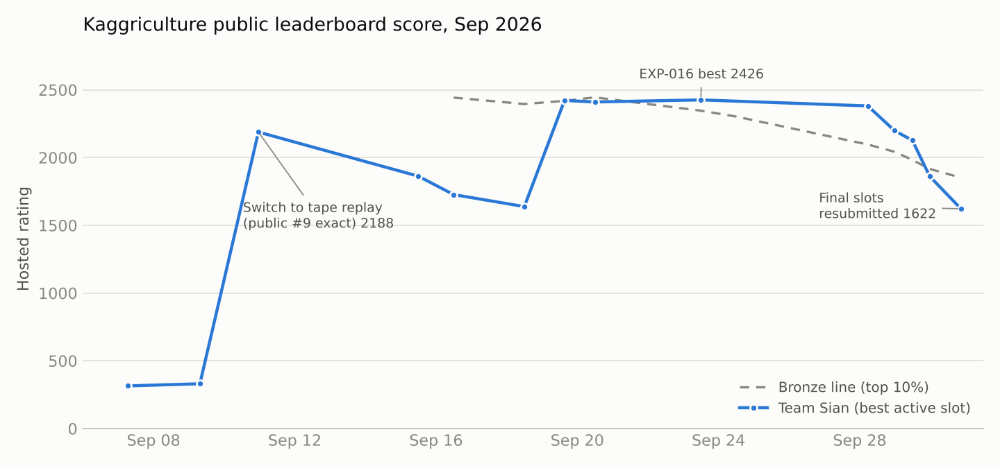
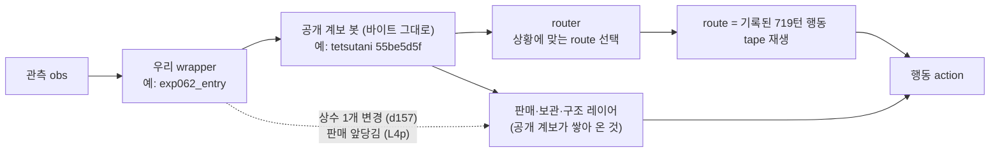
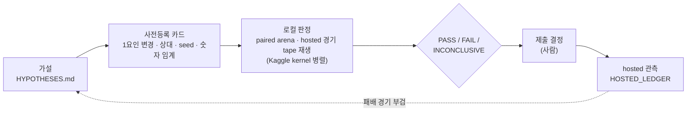

# Kaggriculture — 솔로 참가 회고: 최고 2425.7, 메달 미획득

Kaggle [Kaggriculture](https://www.kaggle.com/competitions/kaggriculture)(2026년 9월, 2인 농장 경영 시뮬레이션, 최종 순위 = Bradley-Terry)에
솔로 팀 **Sian** 으로 참가한 기록이다. 한때 동메달권에 들었지만 마감 직전 슬롯 교체로 점수가 다시 쌓이는 상태에서 끝났다.
사람 1명과 LLM 에이전트 여러 개(Claude, Codex, Gemini/Antigravity, GPT-5.6 Sol)가 한 작업 폴더를 나눠 쓰며 운영했다.

**바로 가기** · [실험 로그](experiments/EXPERIMENT_LOG.md) · [운영 회고](plan/kaggriculture_process_retrospective_claude-opus-5.5.md) ·
[멀티에이전트 운영 방식](writeup/multi-agent-workflow.md) · [제출한 봇](releases/) · [English summary](#english-summary)

<picture>
  <source media="(prefers-color-scheme: dark)" srcset="media/score_trajectory_dark.png">
  
</picture>

| | |
|---|---|
| 제출 | 25회 (하루 5회, 최신 2개만 활성·최종 평가) |
| 대회 중 최고 | **2425.7** — EXP-016, 09-23, 약 808위 / 9,886팀 (당시 동메달선 2346.1) |
| 마감 직후 | 1622.2, 1,855위 / 10,230팀 (10-01 05:47 KST, 재제출본이 600점부터 재수렴 중). 동메달선 1852.0 |
| 최종 BT 순위 | 공개 시점 기준 평가 진행 중 |

## 한 줄 요약

직접 짠 규칙기반 봇(≈340)은 상위 봇에게 400판 중 한 판도 못 이겼다. 상위권처럼 **잘 된 경기의 행동 기록(tape)을 재생하는 봇**으로 바꾸자 2,188점이 됐고,
그 시점 가장 강한 공개 계보를 골라 판매 레이어를 얹어 2,425.7까지 올랐다. 이후의 미세 개선은 **로컬에서 이긴다고 나와도 실전에서는 재현되지 않았고**,
마지막 이틀의 잦은 슬롯 교체가 점수를 처음부터 다시 쌓게 만들었다.

## 접근 방식

### 봇 구조

제출 봇은 모두 공개 Apache-2.0 계보 파일을 바이트 그대로 두고, 끝에 우리 wrapper 를 덧붙이는 형태다(엔진 진입점 = 파일의 마지막 callable).



### 실험 루프



### 단계별 흐름

| 단계 | 기간 | 질문 → 결론 | 점수 |
|---|---|---|---|
| 0 계획·측정 장비 | 09-02~06 | 에이전트 셋의 계획서를 교차 검토해 정본화, 엔진 고정, paired arena·무음 실패 계측기 | — |
| 1 규칙기반 봇 | 09-07~09 | 직접 짠 실행기로 상위 봇을 이길 수 있나? → 공개 4봇 상대 **0/0/400** | 315 → 344 |
| 2 RESET → tape router | 09-10~15 | 공개 9위 tape router 무수정 복제 → 우리 실행기를 929/11로 압도 | **2188** → 1863 |
| 3 정합성·귀인 | 09-16~18 | release gate·패배 원인 귀인. 측정은 정밀했지만 제출 개선 없음 | 1863 → 1638 |
| 4 공개 계보 갈아타기 | 09-19~24 | 공개 최강 계보 exact 복제를 돌려가며 제출, 판매 레이어 이식(EXP-016) | **2422 → 2426** |
| 5 동결 지표 탐색 | 09-25~27 | 자동 탐색용 지표 calibration → 변별력 ≈0으로 중단. 상수 ±1 screen으로 d157 | 2190 → 2401 |
| 6 d157 개선·분산 | 09-28~29 | 판매 hook·상대 모형·생산 재설계·route 재배정 → 대부분 FAIL | 2381 → 1862 |
| 7 마지막 날 | 09-30 | hosted 542판 진단 → glut lead(L4p). 최종 {L4p 사본, d157 사본} | 1622 (재수렴 중) |

## 무엇이 통했고 무엇이 안 통했나

| 통한 것 | 근거 |
|---|---|
| 규칙기반 → tape 재생 계열 전환 | hosted 343.9 → 2188.4 ([RESET](coordination/RESET_2026-09-10.md)) |
| 그 시점 최강 공개 계보를 exact 로 따라가기 | lynnsakurai v2 2421.6, 127ed3e6 2314.7 |
| 판매 레이어 이식 (V53 sale-advance → C1) | 2425.7, 대회 최고 ([EXP-016](experiments/cards/EXP-016-c1-sale-advance.md)) |
| 강한 계보 + 상수 1개 | d157 2400.9 ([EXP-035](experiments/exp035_d157/PREREG.md)) |
| hosted 경기를 tape 로 재생해 상대 재현 | 163/163, 136/136, 107/107 경기 일치 |
| 엔진 소스로 직접 확인 | 상점 해금 3일/8개, 진입점 = 마지막 callable ([FACTS](evidence/FACTS.md)) |

| 안 통한 것 | 근거 |
|---|---|
| 직접 짠 실행기와 작물·흡수량 조정 | 공개 4봇 0/0/400 ([EXP-002](experiments/cards/EXP-002-crops.md), [EXP-003](experiments/cards/EXP-003-absorption.md)) |
| tape 위에서 매도 레이어만 교체 | 농장 계획이 어긋남 ([EXP-005](experiments/cards/EXP-005-x1-probe.md)) |
| 첫 턴 시장 일정 같은 국소 수리 | 회귀 72건 ([EXP-008](experiments/cards/EXP-008-opening-liquidity.md)) |
| 상수 ±1 대량 탐색 (2라운드 이후) | 지던 상대에게 ±1 변형 0/171, d157 ±1 158개 변형 최고 +0.01 (EXP-025, EXP-036) |
| 상대 예측·판매 hook, 생산 재설계(토마토·거위) | EXP-045~057의 개선 후보 전부 FAIL ([실험 로그 §5](experiments/EXPERIMENT_LOG.md)) |
| 자동 탐색 루프용 동결 지표 | calibration BLOCKED, 변별력 ≈0 |

### 로컬 판정과 실전 결과 대조 (CV ↔ LB)

같은 계보 안의 미세 변경은 로컬 우위가 실전에서 거의 재현되지 않았다. 다른 계보끼리의 큰 차이는 맞았다.

| 제출 | 로컬 근거 | 실전(hosted) | 일치 |
|---|---|---|---|
| lynnsakurai v2 exact | round-robin 0.9667 (1위) | 2421.6, 당시 최고 | ✓ |
| 127ed3e6 exact | vs DP 0.821 | 2314.7 > DP 2191.6 | ✓ |
| d157 | tape vs v074 +0.29 | 2400.9 vs v074 2215.9 | ✓ |
| EXP-017 | vs EXP-016 **78/0/2** | EXP-016보다 **−165.6** | ✗ |
| c26 | tape vs d157 +0.033 | 1,887~1,940 vs d157 ~2,200 | ✗ |
| X (Rc26_107) | holdout 0.571 vs d157 0.462 | 1658.1 vs d157r 1888.4 | ✗ |

전체 19건 대조와 원인 분석은 [실험 로그 §7](experiments/EXPERIMENT_LOG.md).

## 왜 메달을 못 땄나

1. **평가기를 검증하기 전에 평가기로 골랐다.** 로컬 지표가 실전 순서를 맞히는지 처음 잰 것은 4주차(09-25)였고 결과는 BLOCKED였다.
   그 뒤에도 같은 계열 미세 변경을 로컬 지표로 골라 제출했다.
2. **가장 큰 상승 두 번은 모두 "공개 최강 봇을 그대로 낸 날"이었고, 그 결정이 늦었다.** 대회 시작 후 8일, 17일째였다.
   공개 코드 파생물을 쓰지 않는다는 초기 방침이 원인이었다.
3. **판정과 제출 결정을 분리하지 않았다.** 사전등록 FAIL·INCONCLUSIVE 를 사람 결정으로 넘어선 제출이 6건 이상이었다(그중 EXP-016이 최고점).
   제출 규칙 자체는 미리 정해 두지 않았다.
4. **마지막 이틀 동안 슬롯을 6번 교체했다.** 최종 BT 는 활성 제출끼리의 경기만 세고, 재제출은 600점에서 다시 시작한다.
   같은 바이트의 d157 이 09-28엔 2400.9였지만 09-30 재제출본은 다음 날 아침 1622.2였다(리그 전체 하락분도 섞여 있다).
5. **조율 비용이 컸다.** 실험 62개에 조율 문서 약 440개가 쌓였다. 09-16~18 사흘은 정합성 작업에 쓰는 동안 제출 개선이 없었다.

다음 대회용 체크리스트는 [실험 로그 §9](experiments/EXPERIMENT_LOG.md), 운영 방식 개선안은 [회고 §4](plan/kaggriculture_process_retrospective_claude-opus-5.5.md).

## 빠르게 실행해 보기

```bash
python3 -m venv .venv && . .venv/bin/activate
pip install -r requirements.lock pytest            # kaggle-environments==1.32.7, Python ≥ 3.11

# 최종 슬롯 봇(L4p) vs 기본 starter 한 판
python3 - <<'EOF'
from kaggle_environments import make
env = make("kaggriculture", configuration={"episodeSteps": 720, "seed": 7})
env.run(["releases/exp062-L4p/main.py", "starter"])
print([round(s.reward) for s in env.steps[-1]])     # 최종 은행 잔고 [L4p, starter]
EOF

python3 scripts/verify_engine_facts.py             # 엔진 사실 재현
python3 -m pytest -q tests                         # 하네스 단위 테스트
```

이 저장소에서 확인한 결과(2026-10-12): 위 대전은 seed 7·11 모두 L4p 가 starter 를 이겼다(168,074 대 3,421 / 195,049 대 3,421).
L4p 와 d157 은 같은 두 seed 에서 1승 1패였다. `verify_engine_facts.py` 는 끝까지 돈다.
단위 테스트는 101개 중 91개가 통과하고, 나머지 10개는 이 저장소에서 뺀 입력(공개 노트북 추출본, 생성된 변형 봇, 원시 결과 JSON,
묶음으로 합친 개별 제안서 파일)을 직접 읽는 테스트다. 실험 스크립트 다수도 대용량 원시 입력을 전제로 하므로 그대로는 돌지 않는다.

## 저장소 구조

| 경로 | 내용 |
|---|---|
| [`releases/`](releases/) | 우리가 만들고 검증·제출한 봇 15종. 최종 두 슬롯 = `exp062-L4p`, `exp035-d157` |
| [`experiments/`](experiments/) | 사전등록 카드(`cards/`, `exp*/PREREG.md`), 판정 스크립트, [`EXPERIMENT_LOG.md`](experiments/EXPERIMENT_LOG.md) |
| [`evidence/`](evidence/) | [FACTS](evidence/FACTS.md)(재현 명령이 붙은 사실) · [KILLS](evidence/KILLS.md)(죽은 방향) · [HOSTED_LEDGER](evidence/HOSTED_LEDGER.md)(제출 원장) · 엔진 사실 · 부검 |
| [`analysis/`](analysis/) | hosted 경기 지도, 패배 분석, 상대 식별, 커뮤니티 조사 메모 |
| [`tools/`](tools/) [`tests/`](tests/) [`scripts/`](scripts/) | arena, 계측기, 탐색 루프, gate 검증, 리플레이 재현·부검 / 단위 테스트 / 엔진 사실 재현·수집 |
| [`plan/`](plan/) | 모델별 계획서, 마감 계획, 회고 |
| [`coordination/`](coordination/) | BOARD · TASKS · HANDOFF · RESET, 에이전트별 보고·제안 묶음 |
| [`writeup/`](writeup/) | 이 저장소용으로 새로 쓴 정리 문서 |
| [`AGENTS.md`](AGENTS.md) [`CLAUDE.md`](CLAUDE.md) [`GEMINI.md`](GEMINI.md) [`HYPOTHESES.md`](HYPOTHESES.md) | 에이전트 계약·역할, 공용 가설 원장 |
| [`media/`](media/) | README 그림과 생성 스크립트 |

**읽는 순서** — 무엇을 했나: [실험 로그](experiments/EXPERIMENT_LOG.md) §1 → §3 제출 원장 → §5 실험 대장 → §7 CV↔LB.
어떻게 일했나: [멀티에이전트 운영](writeup/multi-agent-workflow.md) → [운영 회고](plan/kaggriculture_process_retrospective_claude-opus-5.5.md).
실험 하나를 자세히: [`experiments/cards/`](experiments/cards/) 의 카드나 [`experiments/exp062/PREREG.md`](experiments/exp062/PREREG.md).

`coordination/reports_<agent>.md`, `proposals_<agent>.md` 는 원래 개별 파일(보고 222건, 제안·지시서 150건)을 에이전트별로 시간순으로 이어 붙인 묶음이다.
각 절 제목이 원래 경로이므로, 다른 문서가 `coordination/reports/claude/2026...md` 를 인용하면 해당 묶음에서 그 경로로 검색하면 된다.
문서 안의 다른 경로는 원래 작업 폴더 기준이며, 아래 "포함하지 않은 것"에 해당하는 경로는 이 저장소에 없다.

## 멀티에이전트 운영

에이전트마다 쓰기 소유 폴더를 나누고, `AGENTS.md` 계약(진실의 순위, 증거 꼬리표, 한 파일 한 writer, "모호하면 BLOCKED", 사전등록)과
파일만으로 소통했다. 엔진 확인 습관과 독립 검토는 실제 오류를 여러 번 걸렀지만, 판단 왕복마다 문서가 쌓여 조율 비용이 실험 비용보다 컸다.
역할, 채널, 통한 것과 비쌌던 것, 다음에 바꿀 것은 [writeup/multi-agent-workflow.md](writeup/multi-agent-workflow.md) 에 정리했다.

## 포함하지 않은 것

| 제외 | 이유 |
|---|---|
| 원시 리플레이·경기 결과(`private_artifacts/`, `analysis/**/replays`, `evidence/raw`, `*.jsonl`, 판정·요약 외 결과 JSON), 약 45GB | 용량. 재수집 가능 |
| 대량 생성된 후보 봇(상수 변형 수천 개)과 Kaggle kernel 출력 | 용량. 생성 스크립트는 포함 |
| 남이 쓴 공개 노트북 원본(`releases/public-*-exact`, `opponents/`, 원 작업 폴더의 `docs/`, `**/extracted`, 다운로드한 상대 봇) | 우리 저작물이 아님. 출처는 [`environment/LICENSES.md`](environment/LICENSES.md) |
| 대회 데이터, 리더보드 CSV | 재배포하지 않음 |
| 자격증명(`kaggle.json`), 개인 경로·연락처·Kaggle 계정명 | 보안. 로컬 경로는 `~`, 계정명은 `<kaggle_user>` 로 치환 |
| 일회성 루트 스크립트, `scratch/`, 가상환경 | 정리 |

git 이력은 원래 작업 폴더의 91개 커밋을 가져오지 않고 이 정리본에서 새로 시작했다(이전 이력에 대용량 리플레이가 섞여 있었다).

## English summary

**What this is.** A post-mortem of a solo entry (team *Sian*) in Kaggle's *Kaggriculture* (Sep 2026; two-player, 720-turn farming
simulation; final ranking by Bradley-Terry over matches between each team's two active submissions). It contains the harness and
analysis tools, every bot we derived and submitted, pre-registered experiment cards and verdicts, and the coordination log of a
human working with several LLM agents (Claude, Codex, Gemini/Antigravity, GPT-5.6 "Sol") in one shared folder.

**Result.** 25 submissions. Best observed rating **2425.7** (EXP-016, ~808th of 9,886, above that day's bronze line of 2346.1).
Both slots were resubmitted at the deadline and were re-converging from 600; last observed **1622.2, 1,855th of 10,230**
(2026-10-01). No medal. Final Bradley-Terry results were still being computed at publication.

**Trajectory.** Hand-written rule-based bot (≈340, 0/0/400 against top public bots) → replaying recorded action tapes like the top
teams (≈2,190) → rotating exact copies of the strongest public lineage plus a ported sale layer (≈2,420) → one-constant searches
(d157, ≈2,400) → late attempts to beat the opponents we were actually losing to.

**Why no medal.**
1. We optimised against local metrics before checking that they predicted the ladder. Across lineages they did; for small variants
   within one lineage they almost never did (EXP-017 beat EXP-016 78/0/2 locally, then scored 165.6 lower).
2. Both big jumps came from submitting the strongest public bot as-is, which we only did on days 8 and 17.
3. Pre-registered verdicts and submission decisions were not separated; at least six submissions overrode a verdict.
4. Six slot changes in the last two days restarted ratings from 600.
5. Coordination overhead (≈440 documents for 62 experiments) outweighed experiment cost.

**Worth reusing.** The agent contract ([`AGENTS.md`](AGENTS.md)), the experiment log format with a CV↔LB table
([`experiments/EXPERIMENT_LOG.md`](experiments/EXPERIMENT_LOG.md)), and the multi-agent write-up
([`writeup/multi-agent-workflow.md`](writeup/multi-agent-workflow.md)). Most records are in Korean.

## 라이선스와 출처

[Apache License 2.0](LICENSE). [`releases/`](releases/) 의 봇은 Apache-2.0 공개 Kaggle 노트북의 파생물이며, 원 저자 표기를 각 `main.py` 안에 그대로 유지했다.
라이선스 전문은 `main.py` 안에 있거나, 제출 바이트를 바꾸지 않기 위해 같은 폴더의 `LICENSE.txt` 로 함께 두었다.
upstream 저자: thomastschinkel, yhay81, destbreso, aurax7, tetsutani, prvsiyan, Dmitrii Gluzdov, Ahmed Berat Ozer, nathanjacob, lynnsakurai 외
(전체 목록과 URL 은 [`environment/LICENSES.md`](environment/LICENSES.md)).
게임 엔진은 [kaggle-environments](https://github.com/Kaggle/kaggle-environments) (Apache-2.0).
