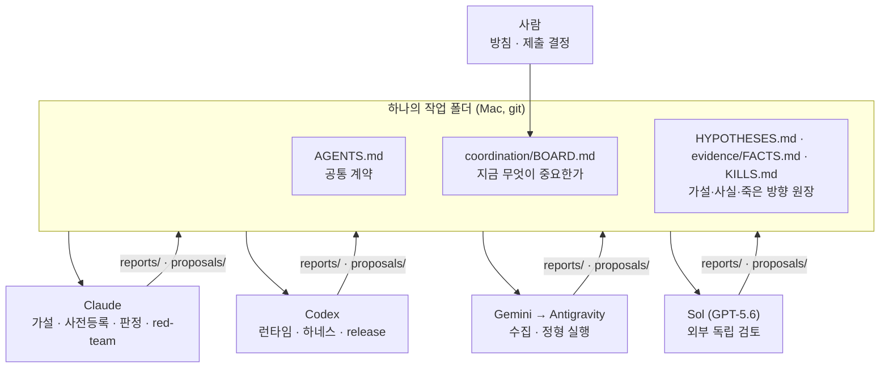

# 사람 1명 + LLM 에이전트 여러 개로 대회를 운영한 방법

> 이 대회에서 가장 남이 따라 해 보기 어려운 부분은 봇이 아니라 운영 방식이다. 2026-10 에 살펴본 Kaggle 솔루션 저장소 11곳 중에는
> 에이전트 협업 기록까지 공개한 곳이 없었다. 여기서는 무엇을 어떻게 나눴고, 무엇이 통했고, 무엇이 비쌌는지를 정리한다.
> 근거: [`AGENTS.md`](../AGENTS.md), [`coordination/`](../coordination/), 그리고 회고 문서
> [`plan/kaggriculture_process_retrospective_claude-opus-5.5.md`](../plan/kaggriculture_process_retrospective_claude-opus-5.5.md).

## 1. 구성

| 역할 | 맡은 일 | 쓰기 소유 경로 |
|---|---|---|
| 사람 | 목표·위험 방침, 제출 승인, 역할 재배정 | — |
| Claude | 경제·게임 가설, 실험 사전등록, 판정, 다른 에이전트 결과의 교차 검증 | `experiments/cards/` `evidence/` `plan/` |
| Codex | 봇 런타임, 하네스·도구, release 빌드 | `main.py` `tools/` `tests/` `releases/` |
| Gemini → Antigravity | 공식 문서·공개 노트북·리플레이 수집, 정해진 경기 실행·집계 | `docs/` `analysis/` `opponents/` |
| Sol (GPT-5.6, 09-28~) | 제출 직전 결정에 대한 외부 검토 (7회) | — |

코디네이터는 Claude → Codex(09-15) → Claude(09-28)로 바뀌었고, 역할 재배정은 09-18, 19, 20, 26에 있었다.

## 2. 계약의 핵심 조항 (`AGENTS.md`)

1. **진실의 순위**: 공식 규정 → 고정된 엔진 소스 → 같은 창의 hosted 경기 → 로컬 실험 → 커뮤니티. 우리 문서끼리 모순되면 엔진으로 판정하고, 진 쪽 문서에 정정 사유를 남긴다.
2. **증거 꼬리표**: `[OFFICIAL] [ENGINE] [HOSTED] [LOCAL] [COMMUNITY] [INFERENCE] [HYPOTHESIS]`. 수치에는 재현 명령이나 `file:line` 을 붙인다. 없으면 사실이 아니라 가설이다.
3. **한 파일 한 writer**: 소유 경로 밖은 `coordination/proposals/<agent>/` 로 제안만 한다.
4. **모호하면 BLOCKED**: 구현자는 서술형 기준을 임의로 해석하지 않고, 해석 후보를 적어 돌려보낸다. 실패가 아니라 계약 준수로 본다.
5. **사전등록**: 실행 전에 카드에 가설·1요인 변경·상대·seed·좌석·숫자 임계를 고정한다. 결과를 보고 표본을 늘리지 않는다.
6. **실패의 범위**: 구현 실패, 운영 결정, 전략 가설을 분리한다. KILL 에는 재검토 조건을 붙인다.
7. **비전공자용 4줄 요약**: 모든 보고는 "무엇을 / 왜 / 무엇을 측정했고 결과는 / 막힌 것과 다음 행동"으로 시작한다.

## 3. 소통 채널 = 파일

메시지 버스를 설계했지만 한 번도 쓰지 않았다. 에이전트별 소유 폴더와 append-only 문서만으로 충분했다.

| 채널 | 건수 | 묶음 파일 |
|---|---|---|
| 완료 보고 `reports/<agent>/` | Codex 80 · Antigravity 86 · Claude 39 · Gemini 10 · Sol 6 · Cowork 1 | [`coordination/reports_*.md`](../coordination/) |
| 제안·지시서 `proposals/<agent>/` | Claude 113 · Codex 31 · Gemini 4 · 기타 2 | [`coordination/proposals_*.md`](../coordination/) |
| 가설 이벤트 `hypotheses/<agent>/` | 89 | [`coordination/hypotheses_events.json`](../coordination/hypotheses_events.json) |

## 4. 통한 것

- **엔진 소스로 확인하는 습관**이 실제 버그를 잡았다: 상점 해금 주기(3일/8개), 엔진 진입점 = 파일의 마지막 callable, BUY_PRODUCT 가격이 단위마다 재평가되는 점.
- **독립 검토자**가 거짓 PASS를 걸렀다: stale artifact(EXP-001), wrapper 자기참조로 186개 변형이 0 action 으로 끝난 사고(INFRA-BUG-001), seat 필터 오류(EXP-025b), gate 정의 오류(F-T7), 측정 불가 결과의 KILL 오등재(K10 철회).
- **소유 폴더 분리** 이후 같은 파일 충돌 사고가 다시 나지 않았다(초기 2건).
- **역할 특화**: 판단이 필요 없는 수집·실행은 Antigravity, 판단은 Claude/Codex, 마지막 결정 검토는 외부 모델(Sol)에 맡긴 것이 비용 대비 효과가 컸다.

## 5. 비쌌던 것

- **조율 비용이 실험 비용보다 컸다.** 실험 ID 62개에 조율 문서가 약 440개, 실험 하나에 7개꼴이었다. 판단이 필요한 일은 결국 Claude나 사람에게 돌아왔고, 왕복마다 문서가 2~3개 생겼다.
- **"현재 상태" 문서가 낡았다.** BOARD·HANDOFF·plan/CURRENT 셋이 모두 마감 전에 멈췄다.
- **계약과 실제가 어긋났다.** 09-10 RESET 으로 버린 승격 게이트(§7.1, §7.1b, §7.3)가 `AGENTS.md` 본문에 그대로 남아 있다.
- **사용량 소진**: Codex 는 지시를 끝내기 전에 사용량이 떨어졌고(09-30 완전 소진), Claude 는 컨텍스트가 리셋됐다. 대응 절차가 계약에 없었다.

## 6. 다음에 바꿀 것

| 무엇 | 어떻게 |
|---|---|
| 계약 | `AGENTS.md` 150줄 이하. 폐기 조항은 같은 날 삭제. 새 조항: 평가기 검증 게이트, 제출 정책 사전등록(판정과 분리), 슬롯 교체 상한, 비상 위임, UTC 표기 |
| 상태 문서 | `STATE.md` 하나만 "현재"를 말한다. 매 제출·판정 후 갱신 |
| 실험 | `exp/EXP-NNN/` 한 폴더에 card·run·result·verdict 를 모은다. 실험 원장 CSV 가 ID 발급처 |
| 에이전트 수 | 판단 1 + 실행·수집 1 + 필요할 때만 외부 검토 1. 코디네이터는 대회 내내 고정 |
| 지시서 | 템플릿 1장(목표 / 입력 / 산출 / 판정 기준 / 중지 조건 / 모델·effort)의 칸만 채운다 |
| 외부 접근 | 제출·점수 조회 대기열을 첫날부터 자동화하고, 사람 승인은 실행 버튼 하나로 한다 |
